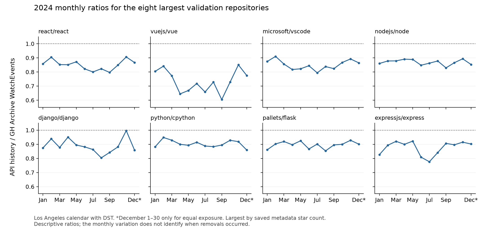

# Star-history validation comparison

All 20 repositories were attempted and captured completely; zero failures. The export contains 175,680 repository-hours including zeros. Comparison uses the same 365 nominal dates under all three hypotheses. This is endpoint validation, not forecast evaluation or an additional confirmatory test.

| Calendar | Mean absolute difference | Exact daily agreement |
|---|---:|---:|
| America/Los_Angeles | 1.975479 | 41.356% |
| UTC | 2.713014 | 33.658% |
| UTC-08:00 | 2.064521 | 39.644% |

| DST span | LA/DST MAD | Fixed UTC−8 MAD | UTC MAD |
|---|---:|---:|---:|
| March 3–17 | 1.833 | 1.937 | 2.710 |
| March 10 only | 2.500 | 3.250 | 1.950 |
| October 27–November 10 | 1.730 | 1.793 | 2.790 |
| November 3 only | 2.200 | 1.900 | 1.950 |

Flask on March 10: API 8, LA 9, fixed UTC−8 10, UTC 5. On November 3: API 10, LA 10, fixed UTC−8 10, UTC 9. LA transition bins contain 23 and 25 hours. The exact transition dates do not uniformly favor LA across repositories; the full-year and transition-window evidence is retained.

| Repository | LA MAD / agreement | Fixed UTC−8 MAD / agreement | UTC MAD / agreement |
|---|---:|---:|---:|
| AppliedMechanics-EAFIT/SolidsPy | 0.0219 / 97.81% | 0.0384 / 96.16% | 0.0712 / 92.88% |
| asciidoc-py/asciidoc-py | 0.0082 / 99.45% | 0.0082 / 99.45% | 0.0411 / 96.71% |
| bwaldvogel/neighbourhood | 0.0055 / 99.45% | 0.0055 / 99.45% | 0.0219 / 97.81% |
| cjdrake/pyeda | 0.0137 / 98.63% | 0.0192 / 98.08% | 0.0685 / 93.15% |
| django/django | 2.8849 / 11.51% | 3.0274 / 12.05% | 4.3288 / 6.85% |
| expressjs/express | 1.7973 / 18.36% | 1.9397 / 15.89% | 2.8986 / 13.15% |
| matplotlib/matplotlib | 0.8110 / 43.29% | 0.9479 / 38.08% | 1.6356 / 19.18% |
| microsoft/vscode | 6.4247 / 3.01% | 6.5507 / 3.56% | 7.4301 / 6.85% |
| nodejs/node | 3.8438 / 6.85% | 4.0247 / 5.75% | 5.2000 / 4.66% |
| numpy/numpy | 1.4356 / 23.01% | 1.5562 / 21.64% | 2.5315 / 14.79% |
| pallets/click | 0.5041 / 56.99% | 0.6082 / 50.41% | 1.2849 / 26.03% |
| pallets/flask | 1.6767 / 18.36% | 1.7973 / 17.81% | 2.5014 / 12.88% |
| pandas-dev/pandas | 1.6959 / 21.92% | 1.7507 / 20.00% | 2.5178 / 12.05% |
| polo2ro/imapbox | 0.0027 / 99.73% | 0.0082 / 99.18% | 0.0137 / 98.63% |
| psf/requests | 1.2027 / 33.70% | 1.3233 / 28.77% | 1.9589 / 19.18% |
| python/cpython | 2.6356 / 14.52% | 2.7781 / 13.97% | 3.8247 / 8.22% |
| react/react | 7.8055 / 1.92% | 7.8548 / 1.92% | 8.9863 / 2.74% |
| scikit-learn/scikit-learn | 1.6877 / 19.45% | 1.8795 / 15.62% | 2.5671 / 12.05% |
| scipy/scipy | 0.5726 / 52.88% | 0.6548 / 47.12% | 1.2822 / 27.67% |
| vuejs/vue | 4.4795 / 6.30% | 4.5178 / 7.95% | 5.0959 / 7.67% |

# Validation totals and monthly ratios

Ratios use January 1-December 30: the export lacks the last eight hours of LA December 31. No boundary counts are imputed. Full 366-day API totals and observed partial archive totals are separately recorded, without a full-year matched ratio.

Largest current stargazers_count in metadata saved with the original validation capture; stable repo ID breaks ties. No new API request or selection by ratio.

Ratio means API divided by archive. All tables use Los Angeles with DST.

| Repository | API, matched 365 days | Archive, matched 365 days | Ratio | API, full 366-day 2024 |
|---|---:|---:|---:|---:|
| react/react | 16,080 | 18,907 | 0.8505 | 16,110 |
| vuejs/vue | 4,280 | 5,877 | 0.7283 | 4,282 |
| microsoft/vscode | 12,951 | 15,232 | 0.8502 | 12,977 |
| nodejs/node | 8,672 | 9,975 | 0.8694 | 8,688 |
| django/django | 7,504 | 8,371 | 0.8964 | 7,516 |
| python/cpython | 7,419 | 8,233 | 0.9011 | 7,431 |
| pallets/flask | 3,726 | 4,162 | 0.8952 | 3,728 |
| expressjs/express | 4,015 | 4,567 | 0.8791 | 4,022 |
| scikit-learn/scikit-learn | 4,195 | 4,573 | 0.9173 | 4,201 |
| psf/requests | 1,943 | 2,276 | 0.8537 | 1,946 |
| pandas-dev/pandas | 3,736 | 4,183 | 0.8931 | 3,739 |
| numpy/numpy | 3,318 | 3,688 | 0.8997 | 3,323 |
| matplotlib/matplotlib | 2,025 | 2,161 | 0.9371 | 2,029 |
| pallets/click | 1,357 | 1,365 | 0.9941 | 1,358 |
| scipy/scipy | 1,305 | 1,364 | 0.9567 | 1,306 |
| cjdrake/pyeda | 37 | 32 | 1.1562 | 37 |
| AppliedMechanics-EAFIT/SolidsPy | 35 | 35 | 1.0000 | 35 |
| polo2ro/imapbox | 21 | 22 | 0.9545 | 21 |
| bwaldvogel/neighbourhood | 10 | 8 | 1.2500 | 10 |
| asciidoc-py/asciidoc-py | 16 | 17 | 0.9412 | 16 |

| Repository | Jan | Feb | Mar | Apr | May | Jun | Jul | Aug | Sep | Oct | Nov | Dec 1–30 |
|---|---:|---:|---:|---:|---:|---:|---:|---:|---:|---:|---:|---:|
| react/react | 0.858 | 0.905 | 0.852 | 0.851 | 0.872 | 0.822 | 0.800 | 0.823 | 0.797 | 0.849 | 0.906 | 0.867 |
| vuejs/vue | 0.804 | 0.841 | 0.773 | 0.645 | 0.669 | 0.718 | 0.658 | 0.728 | 0.604 | 0.728 | 0.850 | 0.775 |
| microsoft/vscode | 0.875 | 0.910 | 0.856 | 0.817 | 0.822 | 0.844 | 0.794 | 0.838 | 0.823 | 0.867 | 0.892 | 0.864 |
| nodejs/node | 0.860 | 0.878 | 0.879 | 0.891 | 0.888 | 0.848 | 0.862 | 0.878 | 0.829 | 0.866 | 0.893 | 0.853 |
| django/django | 0.875 | 0.938 | 0.877 | 0.950 | 0.895 | 0.881 | 0.863 | 0.804 | 0.842 | 0.881 | 0.996 | 0.858 |
| python/cpython | 0.882 | 0.948 | 0.929 | 0.900 | 0.893 | 0.914 | 0.888 | 0.883 | 0.894 | 0.928 | 0.919 | 0.859 |
| pallets/flask | 0.861 | 0.902 | 0.919 | 0.897 | 0.924 | 0.866 | 0.901 | 0.853 | 0.895 | 0.900 | 0.928 | 0.901 |
| expressjs/express | 0.827 | 0.893 | 0.921 | 0.899 | 0.922 | 0.809 | 0.776 | 0.841 | 0.906 | 0.896 | 0.915 | 0.902 |

These are descriptive calendar-matched ratios. Their variation does not by itself identify removal timing or establish an age-invariant removal mechanism. The author's accepted endpoint interpretation is stored separately, verbatim, in readiness.json.

